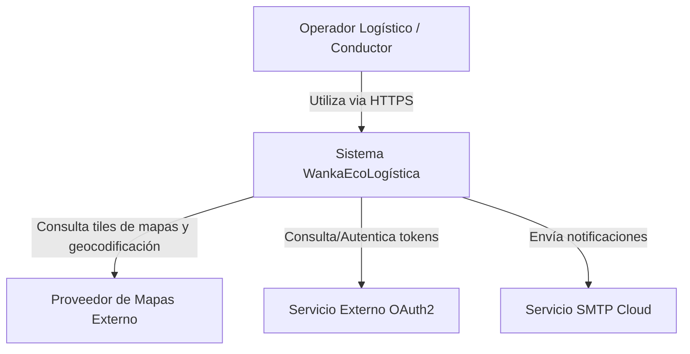
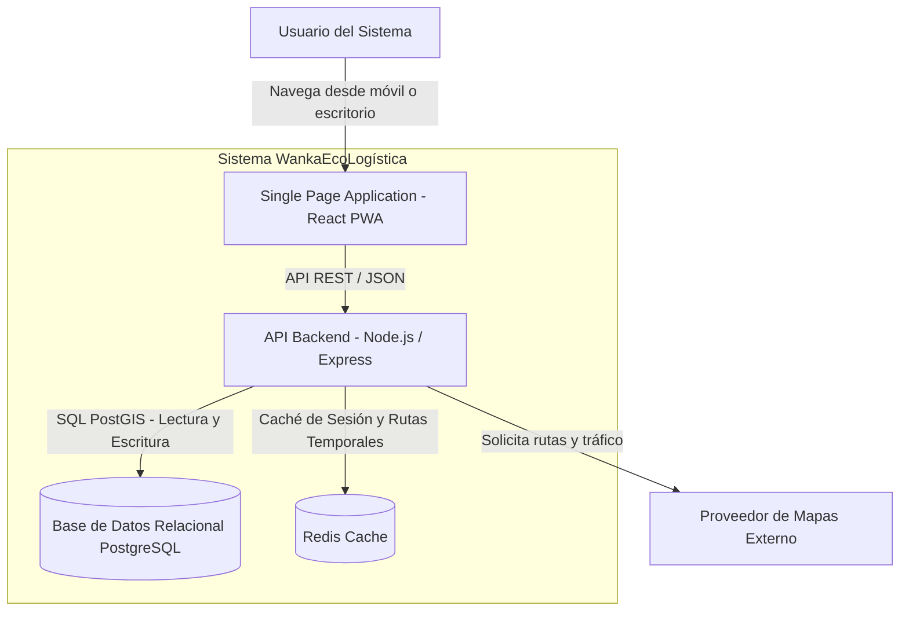
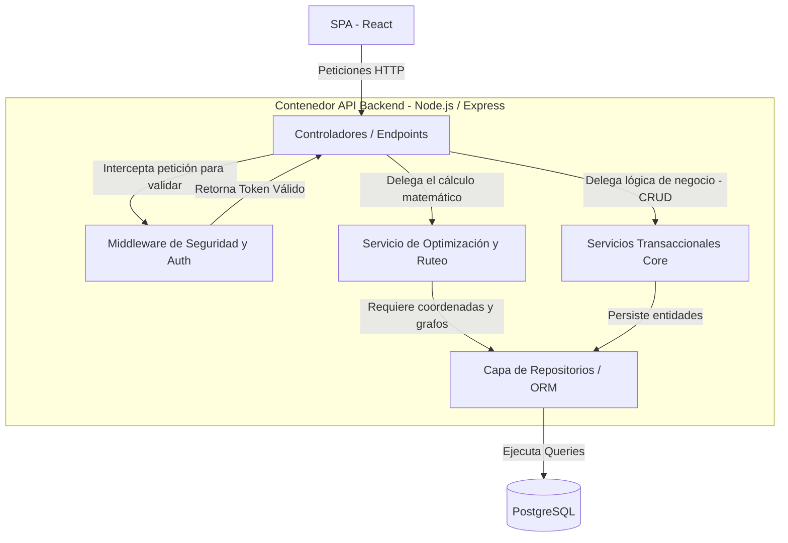

# Arquitectura de Software - Modelo C4

[← Anterior: Base de datos](<11. Base de datos V_1_0_0.md>) · [README principal](../../README.md) · [Siguiente: Restricciones →](<13. Restricciones V_1_0_0.md>)

## Encabezado de Metadatos

| Campo | Información |
|---|---|
| **Nombre del Proyecto** | **WankaEcoLogística Huancayo** |
| **Integrantes** | Michel Frederik Ccente Quispe |
|  | Nario German Reyes Rios |
|  | Henry Lozano Porta |
|  | Jhon Espinoza Mendoza |
|  | Gimena Salazar Espinoza |
| **Fecha** | 04/09/2026 |
| **Versión** | 1.0.0 |

---

## 1. Nivel 1: Diagrama de Contexto

Este nivel muestra el panorama general del sistema **WankaEcoLogística**, los usuarios (actores logísticos) que interactúan con él y los sistemas externos de los que depende para su funcionamiento integral (como servicios de mapas geográficos y mensajería).

---

## 2. Nivel 2: Diagrama de Contenedores

Este diagrama expone las piezas principales de software que componen la plataforma, sus interacciones y las responsabilidades asignadas a cada tecnología seleccionada previamente en la evaluación del stack (Módulo 10).

---

## 3. Nivel 3: Diagrama de Componentes

Este diagrama detalla la estructuración interna de los módulos que componen el contenedor principal de la API Backend (Node.js / Express). Se evidencia una arquitectura por capas limpias, separando las interfaces de red, la lógica algorítmica y el acceso a datos.

---

## 4. Estado de implementación — Sprint 1

La implementación actual materializa la SPA React/Vite, la API Express y PostgreSQL/PostGIS. La API se organiza en rutas HTTP, middleware JWT/RBAC, servicios de dominio y repositorios PostgreSQL; no se usa ORM. El frontend consume JSON mediante `fetch`, conserva la sesión en `sessionStorage` y redirige al login cuando el token vence.

Redis, OAuth2 externo, SMTP, proveedor de mapas y motor de optimización no están conectados en el Sprint 1. Deben considerarse integraciones futuras, no dependencias activas del despliegue local.

**Fin del documento**
