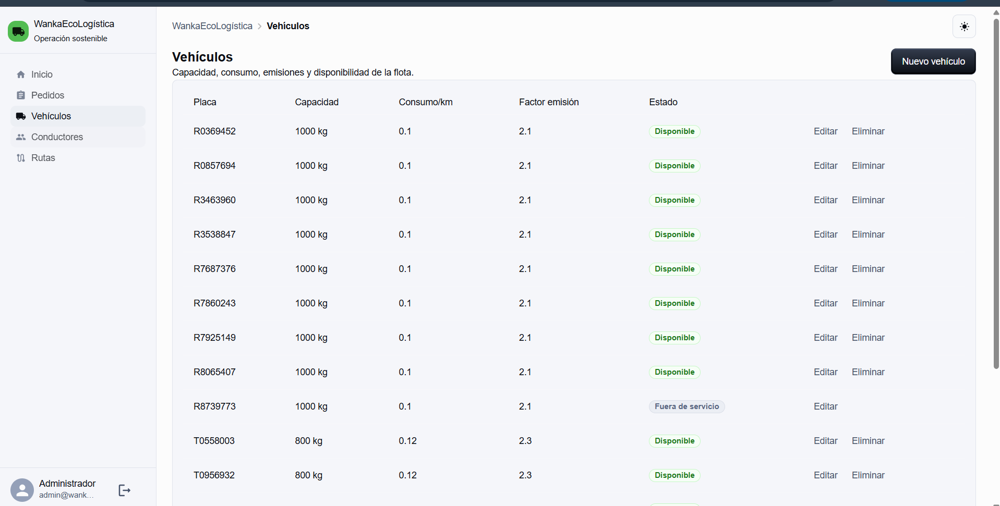
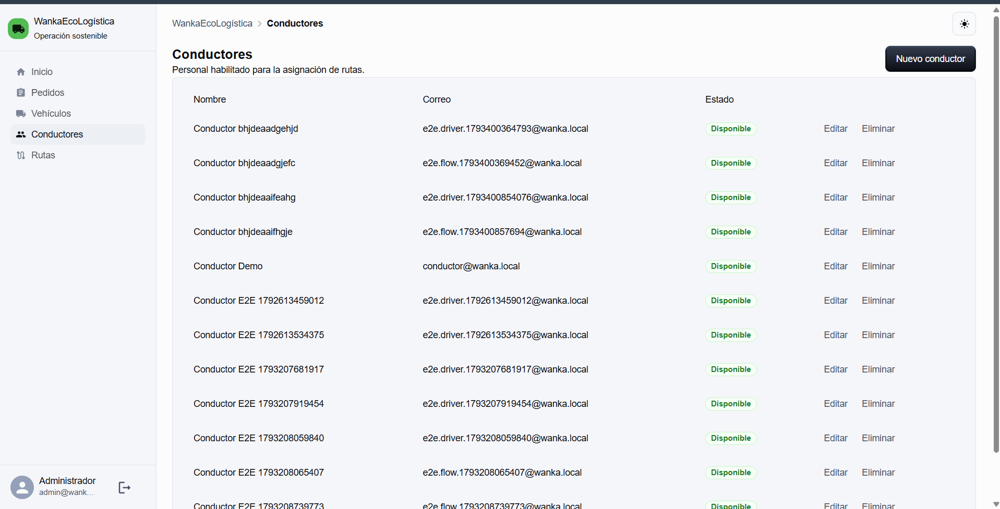
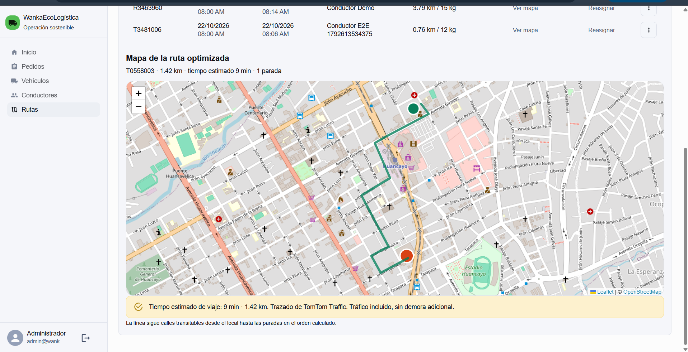

# Revisión del sprint

[← Sprint 2](<../Sprint 2/04 Retrospectiva del Sprint V_1_0_0.md>) · [README principal](../../../README.md) · [Siguiente: Retrospectiva →](<02 Retrospectiva del Sprint V_1_0_0.md>)

**Nombre del proyecto:** WankaEcoLogística Huancayo

**Líder del proyecto:** Nario German Reyes Rios

**Sprint:** 3 — seguimiento de entregas en campo (EP-03)

**Periodo informado:** 20/10/2026–03/11/2026

**Fecha de demostración técnica registrada:** 21/10/2026

**Revisión formal de cierre:** no consta fecha ni acta en la evidencia disponible

**Entorno de demostración registrado:** frontend `http://localhost:5174` y API local

## Objetivo del sprint

Entregar una base funcional para que el conductor autenticado consulte su ruta asignada, visualice sus paradas y trazado, y conserve la última información cargada ante una interrupción de red. El incremento incluye una integración de mapas sustituible para no acoplar la lógica del dominio a un proveedor específico.

## Historias y habilitadores completados

La consigna denomina esta sección “Historias de Usuario”. Para mantener la trazabilidad, se distingue la historia de usuario (US) de los habilitadores técnicos (EN). El estado informado corresponde a Jira al cierre técnico descrito en los documentos del sprint.

| ID del backlog | Tipo | Criterio de aceptación | Estado informado y evidencia |
|---|---|---|---|
| EN-005 | Habilitador técnico — adaptador de mapas | El dominio obtiene rutas mediante un contrato estable y permite sustituir el proveedor o usar un stub en pruebas. | **Listo en Jira, según el registro del equipo.** Se informa `RoutingAdapter` con OSRM, TomTom o stub y pruebas del contrato `calculate()`. |
| US-005 | Historia de usuario — consultar ruta en mapa | Con sesión de conductor, la vista lista únicamente las rutas asignadas; al seleccionar una ruta muestra paradas ordenadas y trazado. Las rutas ajenas se rechazan en el servicio. | **Listo en Jira, según el registro del equipo.** Menú **Mi ruta**, endpoint `GET /api/routes/mine`, autorización por rol y propiedad, vista `DriverRoutePage`. |
| EN-004 | Habilitador técnico — funcionamiento offline | Después de cargar la ruta, al perder conectividad se conserva la última información disponible y se comunica el estado de conexión; al volver la red se solicita actualización. | **Listo en Jira, según el registro del equipo.** Se informa manifest, service worker, caché local y aviso de conectividad. La persistencia se limita a los recursos definidos por la implementación; no implica que toda la aplicación opere sin red. |

### Definición de terminado aplicada

Para declarar un ítem terminado se tomó como referencia que: (1) Jira lo registrara como **Listo**; (2) el comportamiento principal y sus criterios de aceptación pudieran demostrarse en la aplicación; (3) existiera evidencia automatizada del flujo principal; y (4) los controles de autorización relevantes se aplicaran en el backend. Los documentos informan pruebas de adaptador, API y Playwright. Esta revisión no adjunta exportación de Jira ni capturas de la demostración; por ello, el estado y la asistencia se presentan como registros del equipo, no como evidencia visual incluida aquí.

## Demostración del incremento

La demostración técnica registrada el 21/10/2026 siguió este recorrido. Como el periodo informado del sprint se extendía hasta el 03/11/2026, no se presenta esa fecha como cierre formal del sprint:

1. El planificador inicia sesión, registra un pedido geolocalizado y prepara una ruta con vehículo y conductor.
2. El conductor inicia sesión y ve **Inicio** y **Mi ruta**. Los módulos de pedidos, flota y planificación no forman parte de su menú autorizado.
3. En **Mi ruta**, el conductor consulta sus asignaciones. Al abrir una ruta optimizada ve las paradas y el trazado; si no tiene una asignación, recibe un estado vacío explícito.
4. Se interrumpe la conexión después de cargar la ruta. La interfaz indica que está offline y mantiene la última información disponible. Al recuperar red se reactualiza la información.

La evidencia automatizada que el equipo vincula a este recorrido se encuentra en `pruebas/`: `auth.spec.js`, `conductores.spec.js`, `vehiculos.spec.js`, `pedido-en-mapa.spec.js`, `flujo-operativo.spec.js` y `conductor-mi-ruta.spec.js`. La suite requiere el entorno configurado según `pruebas/playwright.config.js`. El equipo había registrado históricamente backend 34/34 con PostGIS y Playwright 3/3; no se conserva aquí la salida de consola ni un artefacto de CI que permita verificar ese conteo, y no se repitió en esta actualización. El workflow [`quality.yml`](../../../.github/workflows/quality.yml) configura un servicio PostGIS y `TEST_DATABASE_URL`, lo cual acredita la configuración, no el resultado de una ejecución.

### Evidencia visual de la versión más reciente del repositorio

| Captura | Qué muestra | Límite de la evidencia |
|---|---|---|
| [Vehículos](pruebas1.png) | Pantalla de flota con capacidad, consumo, factor de emisión y estado. | Es una captura de interfaz; no prueba por sí sola que cada operación CRUD haya pasado. |
| [Conductores](pruebas2.png) | Lista de conductores, cuentas de demostración y estados. | Contiene datos de prueba. No publicar aquí credenciales ni usar estas cuentas en producción. |
| [Mapa de ruta](pruebas3.png) | Ruta optimizada trazada en calles de Huancayo y proveedor de ruteo mostrado en la interfaz. | Corresponde a la vista de planificación; no demuestra por sí sola **Mi ruta** ni el comportamiento offline del conductor. |

**Participación de stakeholders:** la documentación registra una demostración técnica, pero no identifica asistentes ni incorpora acta o comentarios individuales. La sustentación formal de esta consigna ante el docente todavía no está acreditada. Para cerrar este punto se requiere fecha, roles asistentes, comentarios y aceptación; no se deben inferir participantes.

## Pendientes y seguimiento

| Pendiente | Estado al cierre documentado | Seguimiento |
|---|---|---|
| US-006, US-007 y US-008 | Fuera del alcance del Sprint 3 | Mantener en backlog de sprints posteriores. |
| Validar **Mi ruta** offline con Operaciones en un dispositivo móvil real | Pendiente | Registrar dispositivo, navegador, pasos, resultado y observaciones antes de la sustentación. |
| Sustentación documental ante el docente | Pendiente en el registro de la demostración | Presentar los documentos 01–05 y registrar retroalimentación. |
| Evidencia de asistentes y observaciones de stakeholders | No consignada | Añadir acta o resumen cuando exista; no inferir participantes. |

## Control de cambios

| Versión | Fecha | Cambio | Responsable |
|---|---|---|---|
| V_1_0_5 | 30/10/2026 | Se quitan claves Jira no trazables, se aclara que la demo fue técnica/intermedia y se conserva el resultado de pruebas como dato histórico no verificado. | Nario German Reyes Rios |
| V_1_0_4 | 30/10/2026 | Se detallan objetivo, criterios de aceptación, alcance de la evidencia y pendientes sin atribuir asistentes no registrados. | Nario German Reyes Rios |
| V_1_0_3 | 27/10/2026 | Revisión alineada a la plantilla oficial y con líder del proyecto. | Nario German Reyes Rios |
| V_1_0_2 | 21/10/2026 | Revisión sin credenciales y pendientes actualizados. | Equipo del proyecto |
| V_1_0_0 | 21/10/2026 | Plantilla de revisión al inicio del sprint. | Equipo del proyecto |
