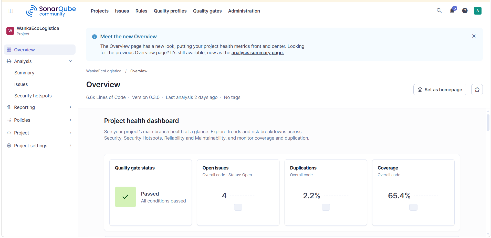

# Evaluación de Calidad de Código — SonarQube

[← Anterior: Retrospectiva](<02 Retrospectiva del Sprint V_1_0_0.md>) · [README principal](../../../README.md) · [Siguiente: OWASP →](<04 OWASP V_1_0_0.md>)

**Nombre del proyecto:** WankaEcoLogística Huancayo

**Fecha del análisis documentado:** 2026-10-28

**Versión del análisis:** V_1_0_0

**Líder del proyecto:** Nario German Reyes Rios

**Herramienta:** SonarQube Community Build `26.10.0.133078`; escáner `@sonar/scan`

**Configuración del análisis:** [`sonar-project.properties`](../../../sonar-project.properties) y [`docker-compose.sonarqube.yml`](../../../docker-compose.sonarqube.yml)

## Alcance y método

El análisis documentado se ejecutó con SonarQube en Docker; el servicio se publicó en `http://localhost:9001` porque el puerto 9000 estaba ocupado en ese entorno. Se analizaron `backend/src` y `frontend/src`; el proyecto configura como pruebas `backend/test` y `pruebas`, y excluye dependencias, cobertura, distribución y directorios internos de Sonar. La ruta LCOV configurada es `backend/coverage/lcov.info`.

Los resultados que siguen corresponden al snapshot analizado el **28/10/2026**, que detectó los hallazgos antes de aplicar las remediaciones descritas más adelante. El Quality Gate aparece como aprobado en ese análisis pese a que había incidencias abiertas. No se debe interpretar el estado del Gate como “cero defectos”. La captura adjunta confirma el estado Passed, la cobertura 65,4 %, la duplicación 2,2 % y cuatro incidencias abiertas en total (tres bugs y un code smell). No se adjunta exportación JSON/CSV ni el detalle de las condiciones del Gate; contrastar con el servidor SonarQube si se requiere auditoría independiente.

## 1. Resumen ejecutivo de Quality Gate

| Indicador | Resultado del snapshot | Interpretación |
|---|---:|---|
| Quality Gate | **PASSED** | La captura muestra “All conditions passed”. El Gate aprobado coexistía con tres bugs y un code smell abiertos. No se conserva el detalle de sus condiciones. |
| Cobertura de líneas | **65,4 %** | Valor informado para el alcance del proyecto analizado. La configuración apunta al LCOV de backend; el frontend no aporta cobertura unitaria en este informe. |
| Duplicación | **2,2 %** | Duplicación informada por SonarQube para el snapshot. |
| Líneas de código | **6 638** | Tamaño de código informado en el análisis. |
| Deuda técnica | **20 minutos** | Estimación de remediación consignada para el code smell del snapshot. La captura adjunta no muestra esta métrica; confirmar el valor con el detalle/exportación de SonarQube. No es una estimación posterior a las correcciones. |

La cifra de cobertura **65,4 %** es la que muestra SonarQube para el alcance de su análisis. La importación LCOV configurada procede del backend (`backend/coverage/lcov.info`); el frontend no aporta informe LCOV en esta configuración. No se presenta aquí otro porcentaje de cobertura del backend porque el resultado histórico que lo consignaba ya no forma parte de la entrega actual y no se volvió a ejecutar el test runner.

## 2. Métricas principales

La tabla conserva las categorías que pide la consigna. `MAJOR` es la severidad de SonarQube reportada; la equivalencia “Alta” es la escala resumida usada para esta entrega.

| Categoría | Cantidad detectada | Severidad informada | Lectura del resultado |
|---|---:|---|---|
| Bugs | 3 | Alta (`MAJOR`) | Tres avisos de promesa no gestionada en el flujo de **Mi ruta**. |
| Vulnerabilidades | 0 | No aplica | El análisis estático no reportó vulnerabilidades en el snapshot. |
| Code Smells | 1 | Alta (`MAJOR`) | Validación de correo susceptible a trabajo innecesario con entradas extensas o malformadas. |
| Security Hotspots | 0 | No aplica | SonarQube no dejó hotspots pendientes de revisión en ese snapshot. |

### Detalle de incidencias abiertas en el snapshot

| ID descriptivo | Comportamiento señalado | Ubicación reportada | Impacto potencial |
|---|---|---|---|
| BUG-1 | La carga de rutas del conductor no expresaba de forma explícita el manejo del rechazo de la promesa. | `frontend/src/features/field/DriverRoutePage.jsx`, línea 91 (según el análisis original) | El rechazo podía quedar sin tratamiento explícito y dificultar el diagnóstico de un fallo al cargar. |
| BUG-2 | La carga de paradas/trazado al seleccionar ruta presentaba el mismo patrón. | Mismo archivo, línea 105 (según el análisis original) | Un fallo de red o API podía producir un rechazo no gestionado. |
| BUG-3 | La sincronización disparada al recuperar conectividad no gestionaba explícitamente el rechazo. | Mismo archivo, línea 149 (según el análisis original) | El fallo de sincronización podía quedar sin tratamiento explícito. |
| SMELL-1 | El patrón de validación de correo podía tardar más con entradas largas o malformadas. | `backend/src/shared/validation.js` | Riesgo de rendimiento y mantenibilidad en validación de entrada; no fue clasificado como vulnerabilidad en ese análisis. |

Las líneas son las reportadas por el análisis de 2026-10-28 y pueden cambiar con nuevas ediciones. La categoría y los identificadores descriptivos de la tabla no sustituyen los identificadores internos de SonarQube.

## 3. Plan de remediación y deuda técnica

| Hallazgo | Corrección documentada | Estado de remediación | Verificación que falta para cerrar evidencia |
|---|---|---|---|
| BUG-1, BUG-2 y BUG-3 | Se declararon explícitamente las operaciones asíncronas de carga y sincronización en `DriverRoutePage.jsx`, conservando la presentación de error al usuario. | Corrección informada como aplicada después del snapshot. | Ejecutar lint/pruebas aplicables y volver a analizar; confirmar que las tres incidencias ya no aparecen y guardar el nuevo resultado. |
| SMELL-1 | `requireEmail` limita la entrada y comprueba componentes básicos del correo sin usar el patrón anterior de costo elevado. | Corrección informada como aplicada en `backend/src/shared/validation.js`. | Ejecutar pruebas de límites/entradas inválidas y reanalizar para confirmar que el smell se cerró. |

**Deuda técnica estimada por el análisis inicial:** 20 minutos.

**Deuda posterior a las correcciones:** no recalculada en un análisis SonarQube posterior documentado.

**Estado de remediación:** cambios descritos como aplicados; falta evidencia de un segundo análisis que confirme el cierre en SonarQube.

### Riesgos y límites de interpretación

- El Quality Gate aprobado describe solo las condiciones configuradas en ese servidor y en ese snapshot; no certifica por sí solo seguridad, accesibilidad ni ausencia de defectos.
- La captura del panel está adjunta, pero no incluye el identificador del análisis, la lista completa de issues ni las condiciones del Gate. Para reproducibilidad, conservar exportación e información de commit, fecha, versión del escáner y parámetros.
- En una comprobación del 30/10/2026 se detectó un error de sintaxis en `backend/src/modules/optimization/optimization.service.js`. Se incorporó la corrección publicada en el commit `ffa1f08` y `node --check` pasó en esta revisión. No se inició la API ni se ejecutó la suite después de actualizar el archivo. Este hallazgo no cambia las métricas del snapshot del 28/10; la validación de runtime y regresión sigue pendiente.

## Control de cambios

| Versión | Fecha | Cambio | Responsable |
|---|---|---|---|
| V_1_0_3 | 30/10/2026 | Se elimina la referencia a la cobertura del informe retirado y se actualiza el seguimiento de sintaxis y validación pendiente. | Nario German Reyes Rios |
| V_1_0_2 | 30/10/2026 | Se incorpora captura de SonarQube y se registra la actualización del código desde el commit remoto `ffa1f08`. | Nario German Reyes Rios |
| V_1_0_1 | 30/10/2026 | Se detalla alcance, snapshot, interpretación de cobertura, remediación pendiente de reanálisis y limitaciones de evidencia. | Nario German Reyes Rios |
| V_1_0_0 | 28/10/2026 | Evaluación inicial con SonarQube en Docker. | Nario German Reyes Rios |
