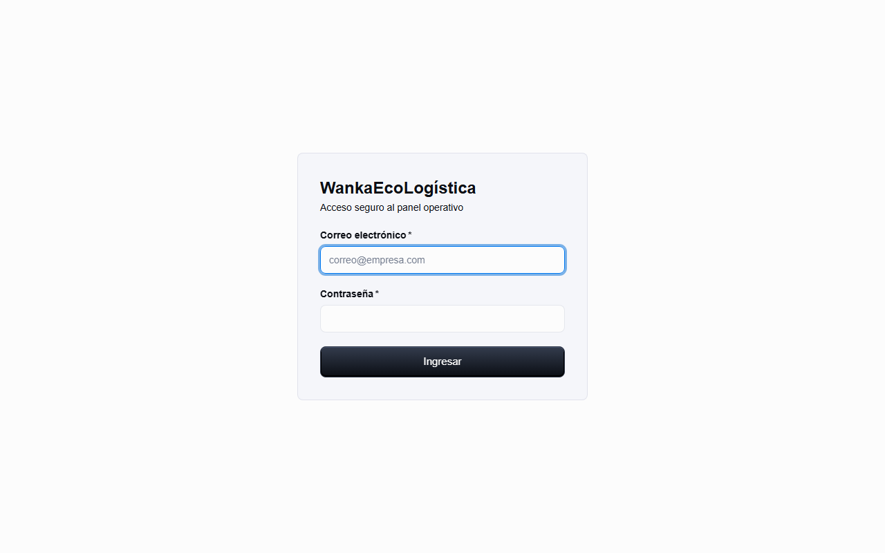
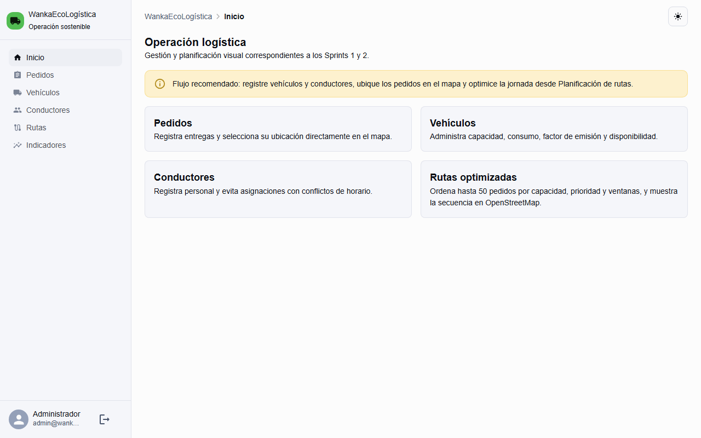
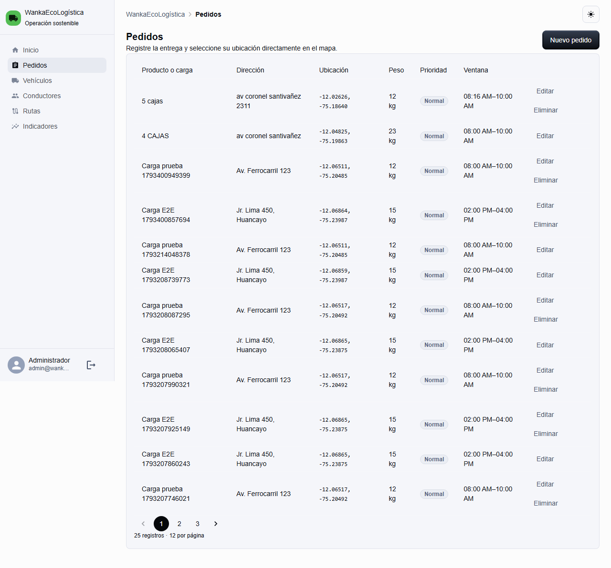
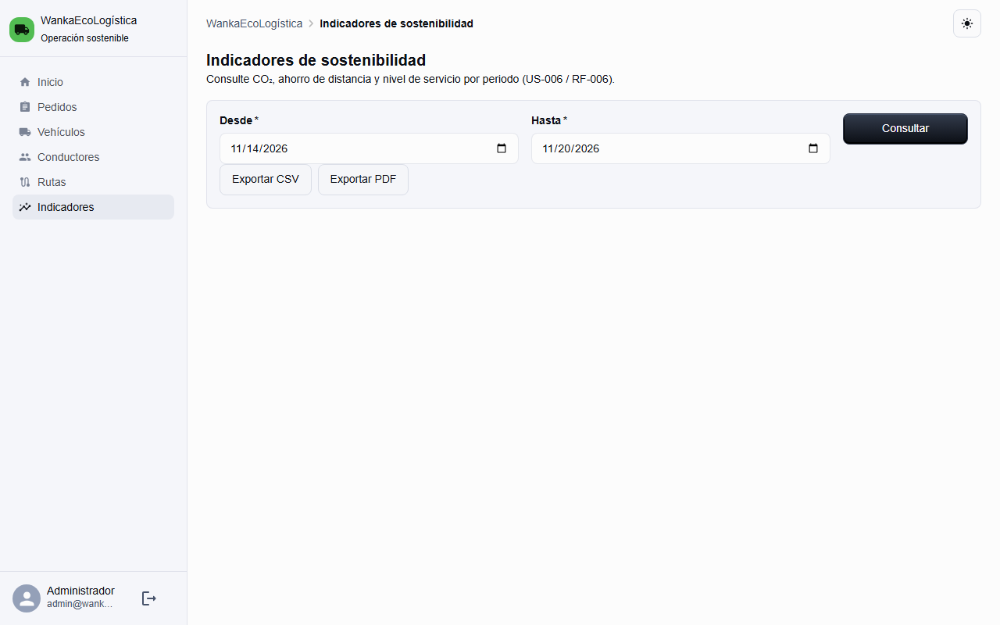
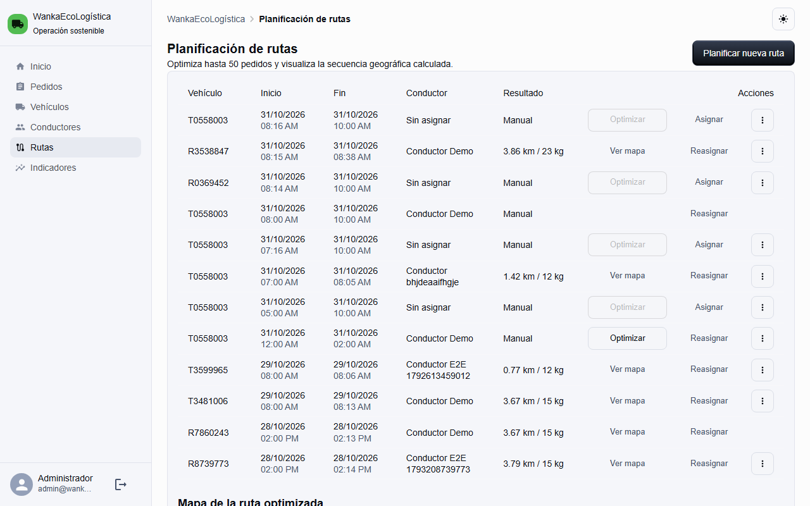
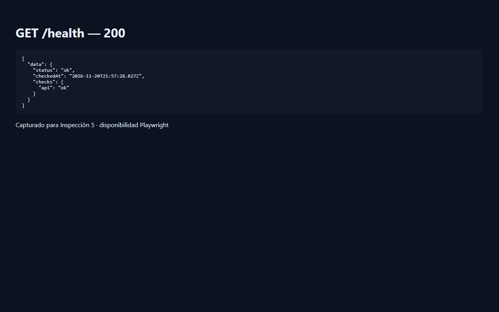
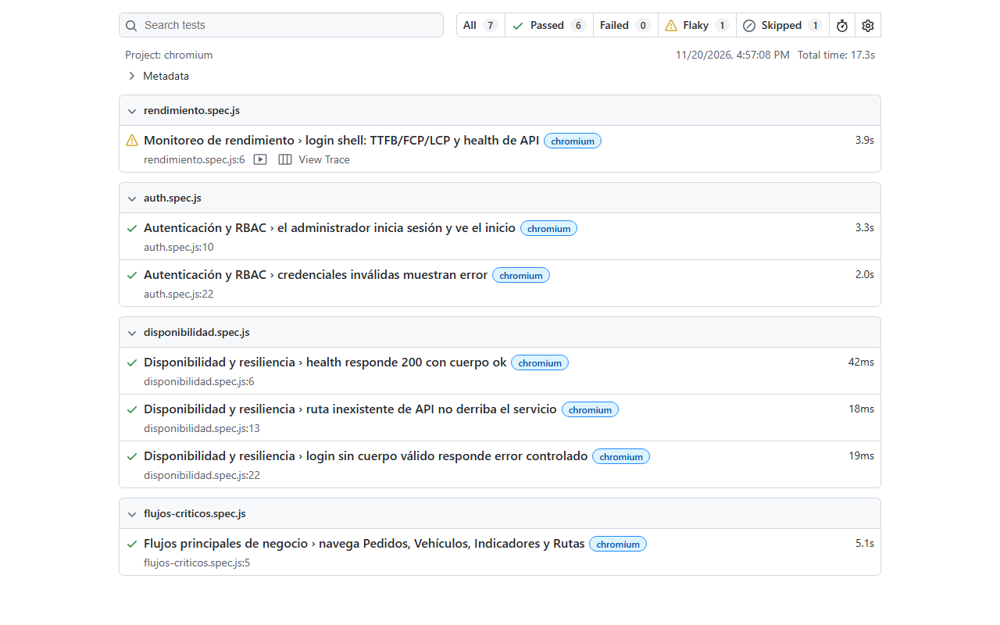

# Análisis Playwright — pruebas E2E, rendimiento y disponibilidad

[← Volver al README principal](../../../README.md) · [← Retrospectiva](<02 Retrospectiva del Sprint V_1_0_0.md>) · [Usabilidad →](<04 Usabilidad V_1_0_0.md>)

**Proyecto:** WankaEcoLogística Huancayo  
**Sprint:** 4 / Inspección 5  
**Fecha:** 20/11/2026  
**Suite canónica:** `frontend/e2e/` + `frontend/playwright.config.js`  
**Suite histórica (Sprint 3):** `pruebas/` (Chromium, flujos largos)

## 1. Configuración del entorno de pruebas

### 1.1 Arquitectura de carpetas

```text
frontend/
├── e2e/
│   ├── helpers/auth.js
│   ├── auth.spec.js              # Autenticación / RBAC
│   ├── flujos-criticos.spec.js   # Navegación de módulos de negocio
│   ├── rendimiento.spec.js       # TTFB, FCP, latencia /health
│   └── disponibilidad.spec.js    # HTTP, errores controlados, uptime básico
└── playwright.config.js          # Chromium, Firefox, WebKit + reporter HTML
```

### 1.2 Navegadores evaluados

| Proyecto Playwright | Motor |
|---|---|
| `chromium` | Desktop Chrome |
| `firefox` | Desktop Firefox |
| `webkit` | Desktop Safari |

Configuración relevante (`playwright.config.js`):

- `testDir: ./e2e`
- `workers: 1`, `fullyParallel: false` (evita colisiones de sesión)
- Reporter `list` + `html` → carpeta `frontend/playwright-report/`
- `baseURL` = `PLAYWRIGHT_BASE_URL` (default `http://localhost:5174`)
- API = `PLAYWRIGHT_API_URL` (default `http://localhost:3000`)

### 1.3 Cómo ejecutar

```powershell
cd frontend
npm install
npx playwright install chromium firefox webkit
# API + frontend levantados; usuarios seed PLAYWRIGHT_EMAIL / PASSWORD
npm run test:e2e
npm run test:e2e:report
```

En CI el workflow `tests.yml` instala navegadores, levanta API/frontend y publica el reporte HTML como artefacto.

## 2. Pruebas End-to-End (E2E)

### 2.1 Casos críticos cubiertos

| Spec | Qué valida |
|---|---|
| `auth.spec.js` | Login admin OK; credenciales inválidas; RBAC conductor (solo Inicio / Mi ruta). |
| `flujos-criticos.spec.js` | Navegación autenticada a Pedidos, Vehículos, Indicadores y Rutas (US-006 visible). |
| `rendimiento.spec.js` | `/health` + métricas de navegación del shell de login. |
| `disponibilidad.spec.js` | 200 en health; 4xx controlado en rutas/login inválidos; servicio sigue arriba. |

Flujos largos de alta (vehículo → pedido → ruta → mapa) permanecen en `pruebas/flujo-operativo.spec.js` para corridas locales headed.

### 2.2 Fragmento representativo

```javascript
test("el administrador inicia sesión y ve el inicio", async ({ page }) => {
  await loginAsAdmin(page);
  await expect(
    page.getByRole("heading", { name: "Operación logística" }),
  ).toBeVisible();
  await expect(page.getByRole("button", { name: "Indicadores" })).toBeVisible();
});
```

### 2.3 Resultados de ejecución (20/11/2026)

| Ámbito | Navegadores | Resultado |
|---|---|---|
| Suite `frontend/e2e` (auth, flujos, disponibilidad, rendimiento) | Chromium | 6/6 críticos OK (1 skipped: conductor sin seed CI) |
| Misma suite | Firefox | 6/6 críticos OK |
| Misma suite | WebKit | 6/6 críticos OK |
| Reporter | HTML | Artefacto local + PNG versionado; CI sube `playwright-report` |

Comando reproducible:

```powershell
cd frontend
$env:PLAYWRIGHT_EMAIL='admin@wanka.local'
$env:PLAYWRIGHT_PASSWORD='WankaAdmin2026'
npm run test:e2e
node scripts/capturar-evidencias-e2e.mjs
```

> El caso de conductor se omite en CI sin `PLAYWRIGHT_DRIVER_READY=1`. Variables: `PLAYWRIGHT_EMAIL`, `PLAYWRIGHT_PASSWORD`, `PLAYWRIGHT_DRIVER_EMAIL`, `PLAYWRIGHT_DRIVER_PASSWORD`.

## 3. Monitoreo de rendimiento

| Métrica | Cómo se obtiene | Umbral aplicado en test |
|---|---|---|
| Latencia API `/health` | `page.request.get` + reloj | &lt; 800 ms local / &lt; 2000 ms CI (meta pedagógica &lt; 500 ms) |
| TTFB | `PerformanceNavigationTiming` | &lt; 3000 ms |
| FCP | `PerformancePaintTiming` | &lt; 5000 ms |
| DCL / Load | Navigation Timing | Registrados en anotación `web-vitals` del reporte |

Las mediciones se serializan en `test.info().annotations` para trazabilidad en el HTML de Playwright. Complementan Lighthouse/SWDM de la Inspección 04 (`evidencias/`).

## 4. Disponibilidad y resiliencia

| Verificación | Resultado esperado |
|---|---|
| `GET /health` | HTTP 200 y estado ok |
| Recurso API inexistente | 404/401/403; `/health` sigue 200 |
| `POST /api/auth/login` vacío | 4xx (no 5xx) |

Esto demuestra que errores de cliente no derriban el proceso Node y que el endpoint de monitoreo permanece disponible en el entorno desplegado/local.

## 5. Evidencias

Capturas versionadas en [`evidencias/`](../../../evidencias/) (20/11/2026):















| Archivo | Contenido |
|---|---|
| [playwright-pantalla-login.png](../../../evidencias/playwright-pantalla-login.png) | Shell de login |
| [playwright-inicio.png](../../../evidencias/playwright-inicio.png) | Dashboard tras login admin |
| [playwright-pedidos.png](../../../evidencias/playwright-pedidos.png) | Módulo Pedidos |
| [playwright-indicadores.png](../../../evidencias/playwright-indicadores.png) | Indicadores (US-006) |
| [playwright-rutas.png](../../../evidencias/playwright-rutas.png) | Planificación de rutas |
| [playwright-health.png](../../../evidencias/playwright-health.png) | `GET /health` |
| [playwright-reporte-html.png](../../../evidencias/playwright-reporte-html.png) | Reporter HTML |

Script: `frontend/scripts/capturar-evidencias-e2e.mjs`.

- Reporte HTML local: `frontend/playwright-report/` (gitignored; PNG sí versionado).
- Artefacto CI: workflow **Tests** → `playwright-report`.
- Suite extendida histórica: `pruebas/`.

**Fin del documento**
