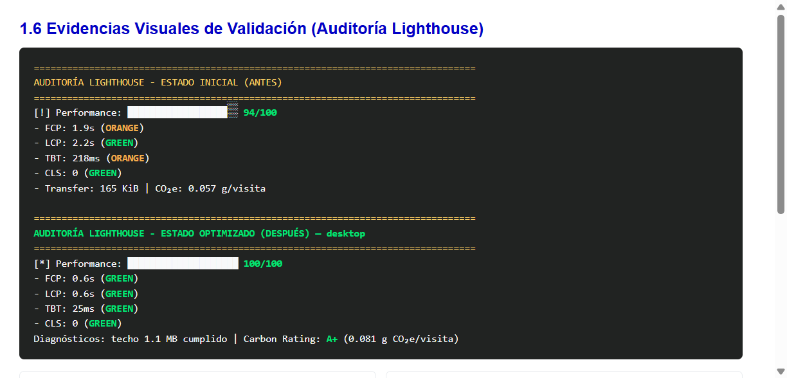
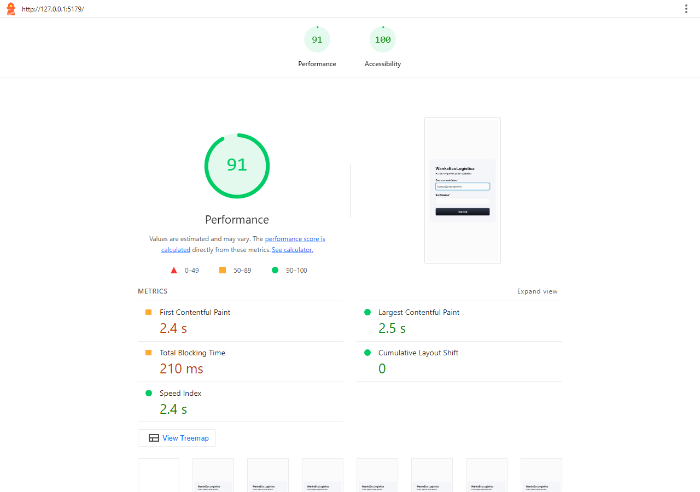

# Estándares de ingeniería de software y guía de desarrollo verde

[← Informe Green IT](<01 Informe de reduccion del impacto ambiental V_1_0_0.md>) · [README principal](../../../README.md) · [Evidencias →](./evidencias/)

**Proyecto:** WankaEcoLogística Huancayo  
**Versión:** 1.0.0  
**Fecha:** 12/11/2026  
**Complementa:** [01 Informe de reduccion del impacto ambiental V_1_0_0.md](<01 Informe de reduccion del impacto ambiental V_1_0_0.md>)

## 2.1 Relación de estándares internacionales aplicados

### ISO/IEC 25010 (calidad del producto de software)

| Subcaracterística | Aplicación en Wanka |
|---|---|
| Eficiencia de desempeño — comportamiento temporal | Compresión Gzip, paginación, índices SQL, code splitting |
| Eficiencia — utilización de recursos | Proyecciones de columnas, límite 50 filas, SVG en lugar de raster pesado |
| Mantenibilidad — modularidad | `React.lazy`, módulos `ops`/`sustainability`, repositorios PostgreSQL |
| Mantenibilidad — analizabilidad | Dependencias mínimas, tests de paginación y recovery |

**Evidencia de eficiencia (Lighthouse ANTES):**


### Principios Green Software Foundation (GSF)

1. **Eficiencia de carbono:** menos bytes por visita y payloads acotados.  
2. **Eficiencia energética:** menos CPU en serialización JSON y render de listas enormes.  
3. **Eficiencia de hardware:** bundles diferidos (Leaflet solo en mapa).  
4. **Medición (SCI-like):** Lighthouse + SWDM v4 versionados en `docs/03 Implementación/reduccion del impacto ambiental/evidencias/`.

**Evidencia de medición (resumen visual ANTES/DESPUÉS):**



### W3C Web Sustainability Guidelines (WSG 1.0)

| Pauta | Cumplimiento |
|---|---|
| 1.2 Media | SVG / sin PNG grandes |
| 2.4 Arquitectura y caché | Lazy routes, ETag, Cache-Control, chunks Vite |
| 3.1 Transferencia de red | Gzip, paginación, SELECT explícito |

**Evidencia WSG (Lighthouse DESPUÉS):**



## 2.2 Buenas prácticas y guía de desarrollo verde PERN

### Normas backend (Node / Express / PostgreSQL)

1. Todo listado público usa `page`/`limit` (default 12, máx. 50).  
2. Consultas de listado proyectan columnas necesarias (sin `SELECT *`).  
3. Middleware `compression` obligatorio para JSON > 1 KB.  
4. Índices para columnas de `ORDER BY` frecuentes.  
5. Clean Code / SOLID / DRY / YAGNI: servicios delgados, repositorios SQL, sin abstracciones especulativas.

### Normas frontend (React / Vite / MUI)

1. Rutas/módulos secundarios con `React.lazy` + `Suspense`.  
2. Prohibido añadir `moment`/`lodash` sin justificación de Bundlephobia.  
3. Imágenes raster > 200 KB deben convertirse a WebP/AVIF o SVG.  
4. Listados consumen la API paginada; no forzar `limit` > 50 salvo casos justificados.  
5. Assets hasheados con caché inmutable en preview/producción.

**Pantalla de referencia (login liviano, sin raster pesado):**


**Proceso autenticado con paginación obligatoria (Pedidos):**


### CI/CD verde

Workflow [`.github/workflows/green-audit.yml`](../../../.github/workflows/green-audit.yml):

- Build del frontend.
- Ejecución de `@lhci/cli` con `frontend/lighthouserc.cjs`.
- Umbrales de performance/accesibilidad en modo `warn` para no bloquear el MVP académico ante variación de runners.

## 2.3 Matriz de mapeo: optimizaciones ↔ estándares

| # | Optimización PERN | ISO/IEC 25010 | GSF | W3C WSG 1.0 |
|---|---|---|---|---|
| 1 | SELECT explícito + índices | Utilización de recursos | Eficiencia de hardware | 3.1 Network |
| 2 | Paginación 12 | Capacidad | Eficiencia energética | 2.1 UX efficiency |
| 3 | SVG / sin raster pesado | Comportamiento temporal | Eficiencia de carbono | 1.2 Media |
| 4 | React.lazy + chunks | Modularidad | Eficiencia de hardware | 2.4 Architecture |
| 5 | Deps mínimas / APIs nativas | Analizabilidad | Eficiencia energética | 2.2 Libraries |
| 6 | Icons empaquetados / menos HTTP | Comportamiento temporal | Eficiencia de carbono | 3.2 HTTP requests |
| 7 | Cache-Control + ETag | Comportamiento temporal | Eficiencia energética | 2.4 Caching |
| 8 | compression Gzip | Capacidad | Eficiencia de carbono | 3.1 Network |

## 2.4 Secuencia Git de entrega (consigna)

```powershell
git status
mkdir "docs/03 Implementación/reduccion del impacto ambiental"
mkdir "docs/03 Implementación/reduccion del impacto ambiental/evidencias"
git add "docs/03 Implementación/reduccion del impacto ambiental/"
git add .github/workflows/green-audit.yml backend frontend
git commit -m "docs(green-it): add PERN performance optimization reports and software engineering standards"
git push origin main
```

**Fin del documento 2**
