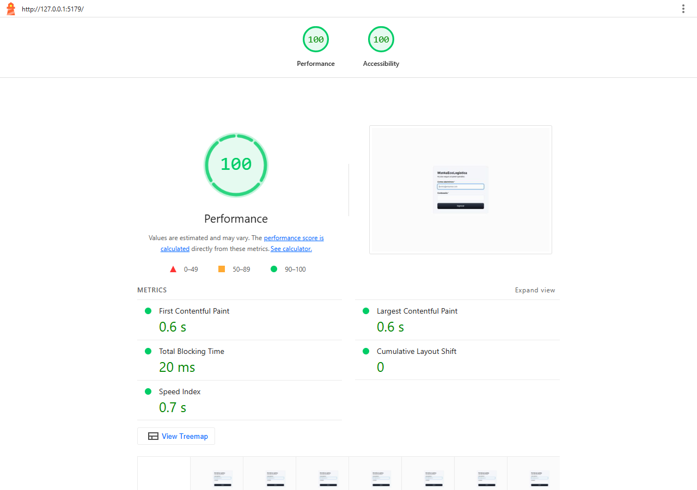
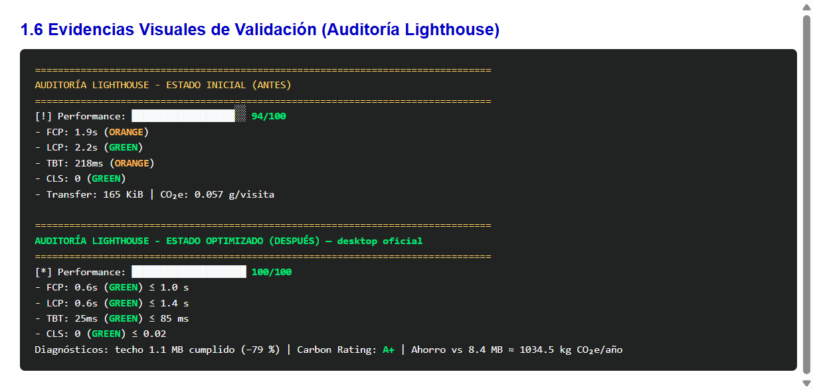
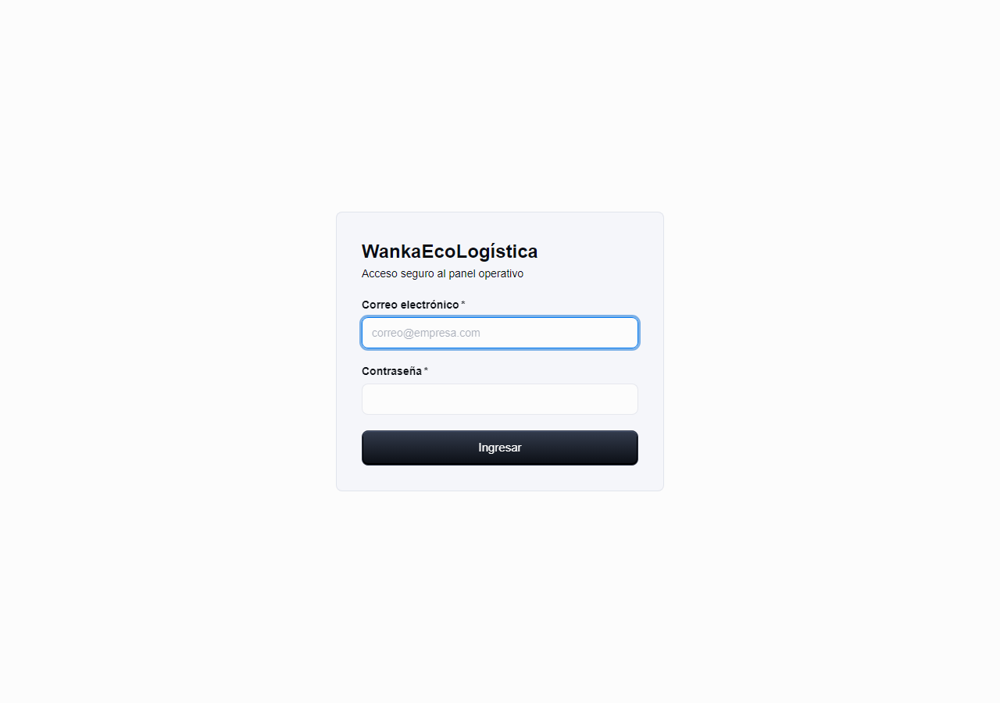
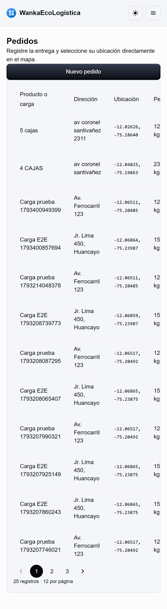

# Estándares de ingeniería de software y guía de desarrollo verde

[← Informe Green IT](<01 Informe de reduccion del impacto ambiental V_1_0_0.md>) · [README principal](../../../README.md) · [Evidencias →](../../../evidencias/)

**Proyecto:** WankaEcoLogística Huancayo  
**Versión:** 1.0.0  
**Fecha:** 12/11/2026  
**Complementa:** [01 Informe de reduccion del impacto ambiental V_1_0_0.md](<01 Informe de reduccion del impacto ambiental V_1_0_0.md>)

## 2.1 Relación de estándares internacionales aplicados

### ISO/IEC 25010 (calidad del producto de software)

Las refactorizaciones Green IT se justifican explícitamente en:

| Subcaracterística | Refactorización aplicada en Wanka |
|---|---|
| Eficiencia de desempeño — comportamiento temporal | Compresión Gzip, code splitting, ETag/`Cache-Control`, FCP/LCP/TBT desktop sobresalientes |
| Eficiencia — utilización de recursos | SELECT explícito, paginación 12, índices SQL, SVG en lugar de raster pesado |
| Eficiencia — capacidad | Límite máx. 50 filas, payloads JSON comprimidos |
| Mantenibilidad — modularidad | `React.lazy`, módulos `ops`/`sustainability`, repositorios PostgreSQL |
| Mantenibilidad — analizabilidad | Dependencias mínimas, tests de paginación y recovery |

**Evidencia ISO (DESPUÉS desktop — Performance 100):**



### Principios Green Software Foundation (GSF)

1. **Eficiencia de carbono:** menos bytes transferidos vs anti-patrón 8.4 MB; proyección de ahorro ≈ 1034.5 kg CO₂e/año.  
2. **Eficiencia energética:** menos CPU en serialización JSON y render de listas paginadas.  
3. **Eficiencia de hardware:** Leaflet diferido; chunks MUI/React separados.  
4. **Medición (SCI-like):** Lighthouse + SWDM v4 versionados en `evidencias/`.



### W3C Web Sustainability Guidelines (WSG 1.0)

| Pauta | Cumplimiento en Wanka |
|---|---|
| 1.2 Media | SVG / sin PNG grandes > 200 KB |
| 2.4 Arquitectura y caché | Lazy routes, ETag, Cache-Control, chunks Vite inmutables |
| 3.1 Transferencia de red | Gzip, paginación, SELECT explícito |

## 2.2 Buenas prácticas y guía de desarrollo verde MERN

### Normas backend (Node / Express / PostgreSQL)

1. Prohibido listados públicos sin `page`/`limit` (default 12, máx. 50).  
2. Consultas de listado proyectan columnas necesarias (equivalente a `.select()` / sin `SELECT *`).  
3. Middleware `compression` obligatorio para JSON > 1 KB.  
4. Índices para columnas de `ORDER BY` frecuentes.  
5. Clean Code / SOLID / DRY / YAGNI: servicios delgados, repositorios SQL, sin abstracciones especulativas.

### Normas frontend (React / Vite / MUI)

1. Módulos secundarios con `React.lazy` + `Suspense`.  
2. Prohibido añadir `moment`/`lodash` sin justificación Bundlephobia.  
3. Imágenes raster > 200 KB → WebP/AVIF o SVG.  
4. Listados consumen API paginada.  
5. Assets hasheados con caché inmutable (`max-age=31536000`).





### Integración CI/CD verde (GitHub Actions)

Archivo [`.github/workflows/green-audit.yml`](../../../.github/workflows/green-audit.yml):

```yaml
name: Green IT & Performance Audit
on:
  pull_request:
  push:
    branches: [main]
jobs:
  lighthouse:
    runs-on: ubuntu-latest
    defaults:
      run:
        working-directory: frontend
    steps:
      - uses: actions/checkout@v4
      - uses: actions/setup-node@v4
        with:
          node-version: 24
          cache: npm
          cache-dependency-path: frontend/package-lock.json
      - run: npm ci
      - run: npm run build
      - name: Run Lighthouse CI
        run: |
          npm install -g @lhci/cli@0.14.0
          lhci autorun --config=./lighthouserc.cjs
```

## 2.3 Matriz de mapeo directo: estándares vs. optimizaciones MERN

| # | Optimización técnica aplicada | ISO/IEC 25010 | Principio GSF | Lineamiento W3C WSG 1.0 |
|---|---|---|---|---|
| 1 | PostgreSQL: SELECT explícito + índices | Eficiencia — utilización de recursos | Eficiencia de hardware | 3.1 Network Data Transfer |
| 2 | Paginación Limit/Offset (12) | Eficiencia — capacidad | Eficiencia energética | 2.1 UX Efficiency |
| 3 | Assets: SVG / sin raster pesado | Eficiencia — comportamiento temporal | Eficiencia de carbono | 1.2 Media Optimization |
| 4 | Lazy loading + code splitting | Mantenibilidad — modularidad | Eficiencia de hardware | 2.4 Code Architecture |
| 5 | Depuración de dependencias / APIs nativas | Mantenibilidad — analizabilidad | Eficiencia energética | 2.2 Clean Code & Libraries |
| 6 | Menos HTTP: icons empaquetados + SVG | Eficiencia — comportamiento temporal | Eficiencia de carbono | 3.2 HTTP Requests Minimization |
| 7 | Caché: ETag + Cache-Control | Eficiencia — comportamiento temporal | Eficiencia energética | 2.4 Caching Strategies |
| 8 | Express: compression Gzip | Eficiencia — capacidad | Eficiencia de carbono | 3.1 Network Optimization |

## 2.4 Secuencia Git de entrega (consigna)

```powershell
git status
mkdir "docs/03 Implementación/reduccion del impacto ambiental"
mkdir evidencias
git add "docs/03 Implementación/reduccion del impacto ambiental/"
git add .github/workflows/green-audit.yml backend frontend
git commit -m "docs(green-it): add MERN performance optimization reports and software engineering standards"
git push origin main
```

**Fin del documento 2**
